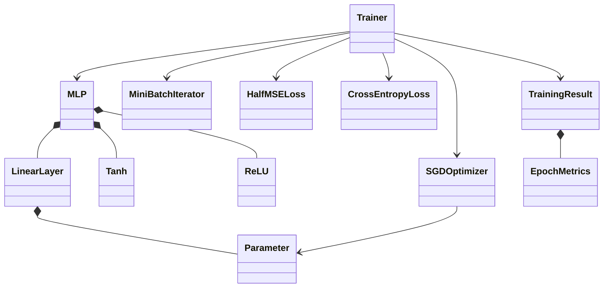

# MLP manual con NumPy

Esta etapa añade `mlvectoranalysis.nn`: redes densas secuenciales float64 para
regresión y clasificación multiclase. Conserva las APIs V1, optimización y
`LinearLeastSquaresObjective`, incluida su media pérdida cuadrática con factor
1/2. No representa pesos con `VectorFunction` ni restringe las redes a 3D.
NumPy ejecuta los productos matriciales; no hay autograd, derivación simbólica,
framework de deep learning ni diferencias finitas durante entrenamiento.

## Componentes y uso

| Archivo | Responsabilidad pública |
| --- | --- |
| `parameters.py` | `Parameter`: buffers propios `data`/`grad`, nombre, versión, `assign`, `zero_grad` |
| `layers.py` | Protocolo `Layer`, `LinearLayer`, contextos de una ejecución |
| `activations.py` | `Tanh`, `ReLU`, sin parámetros |
| `mlp.py` | `MLP`, composición, backward inverso, predicción por bloques |
| `losses.py` | `HalfMSELoss`, `CrossEntropyLoss`, pérdidas sin estado compartido |
| `optimizers.py` | `SGDOptimizer`, validación atómica de candidatos y actualización |
| `data.py` | `MiniBatchIterator`, mezcla reproducible, último lote incluido |
| `training.py` | `TrainingConfig`, `Trainer`, entrenamiento y evaluación separados |
| `training_result.py` | `TrainingResult`, `EpochMetrics`, `EvaluationMetrics`, historial acotado |
| `_validation.py` | Política central float64, validación y `NumericalError` |



```python
import numpy as np
from mlvectoranalysis.nn import MLP, CrossEntropyLoss, SGDOptimizer, Trainer, TrainingConfig

X = np.array([[0., 0.], [0., 1.], [1., 0.], [1., 1.]])
y = np.array([0, 1, 1, 0])
model = MLP([2, 8, 2], activation='tanh', seed=42)
optimizer = SGDOptimizer(model.parameters(), learning_rate=.2)
trainer = Trainer(CrossEntropyLoss(), optimizer,
                  TrainingConfig(epochs=1200, batch_size=4, seed=42))
result = trainer.fit(model, X, y)
probabilities = model.predict_proba(X, batch_size=256)
```

`MLP.from_layers(layers)` permite composición explícita de las capas admitidas.
Valida anchuras, última capa lineal y ausencia de capas/parámetros compartidos.
La topología y los objetos Parameter se fijan al construir el modelo: no se
admite reemplazar capas ni reasignar sus atributos `weight`/`bias`. Use
`parameter.assign(values)` para cambiar los valores. `parameters()` es una
tupla ordenada, peso y sesgo por capa; el optimizador debe referenciar
exactamente esa misma secuencia. No hay herencia de las clases V1.

El protocolo de capas es deliberadamente pequeño: `forward(inputs,
retain_cache=False) -> (outputs, cache)`, `backward(upstream, cache) -> d_inputs`
y `parameters()`. No pretende ofrecer un grafo de cálculo general.

## Formas, reducciones y regla de la cadena

Para un lote `X: (B,d_in)`, `W: (d_in,d_out)` y `b: (d_out,)`:

- `Z = X @ W + b`.
- `dX = dZ @ W.T`, usando los pesos anteriores al paso SGD.
- `dW = X.T @ dZ`, `db = sum(dZ, axis=0)`.
- Tanh: `dX = upstream * (1 - output**2)`.
- ReLU: `dX = upstream * (input > 0)`; derivada en cero igual a cero.

Backward recorre las capas en orden inverso y aplica productos
vector-Jacobiano. No construye Jacobianos/Hessianas completos y no es un
algoritmo codicioso. Los bucles Python recorren capas, lotes y épocas; los
cálculos por muestras/neuronas se realizan con kernels vectorizados.

`HalfMSELoss` exige predicción y target `(B,K)` con dimensiones positivas:

```text
L = sum((pred-target)**2) / (2*B*K)
d_pred = (pred-target) / (B*K)
RMSE = sqrt(2*L)
```

La reducción promedia TODOS los elementos, no solo las filas. Para `K=1`
coincide con la regresión lineal existente. No se permite broadcasting entre
`(B,)` y `(B,1)`. El ejemplo usa targets `(N,1)`. Para reducir overflow
intermedio, la implementación escala residuos por `sqrt(B*K)` antes de
sumar cuadrados; las derivadas conservan la fórmula anterior.

`CrossEntropyLoss` recibe logits `(B,C)`, `C>=2`, y targets enteros `(B,)` en
`[0,C)`. Rechaza booleanos, flotantes e índices fuera de rango. Se resta el
máximo por fila; con `s = logits-max(logits)`, `e=exp(s)`, `z=sum(e)`:

```text
L = mean(log(z) - s[arange(B), targets])
d_logits = (e/z - indicador_de_la_clase_correcta) / B
```

El indicador se aplica mediante indexación, sin materializar one-hot. Se
reutilizan exponenciales/sumas y no se hace `log(softmax)` ni clipping de
probabilidades. Logits de magnitud 1000 están cubiertos por tests; diferencias
como `1e308 - (-1e308)` exceden float64 y generan `NumericalError`.
`value()` calcula solo el escalar; no construye el gradiente descartable de
validación. Ninguna capa ni SGD vuelve a dividir por tamaño del lote.

Todas las ocultas usan la activación elegida y la salida es lineal. Los pesos
se muestrean de una normal con varianza `2/d_in` para ocultas ReLU y
`2/(d_in+d_out)` para Tanh y salida lineal. Sesgos cero; un único Generator
local avanza por las capas, sin reseed por capa ni cambios al RNG global.

## Propiedad de buffers y ciclo de los contextos

`Parameter` copia la entrada numérica a buffers propios mutables float64.
Rechaza complejos, object, strings, bool y no finitos. `data` y `grad`
conservan identidad y almacenamiento durante SGD. `assign()` copia sin
reemplazar el buffer e incrementa su versión. La política de dtype vive en
`_validation.py`; no hay soporte float32 ni mixed precision prometido.

Cada forward retenido crea su propio contexto. Una capa lineal conserva una
**referencia** a su entrada float64, Tanh a su salida, ReLU solo a una máscara
booleana. Si la entrada requiere conversión, el contexto referencia esa nueva
matriz. No se deben mutar entradas ni salidas retenidas antes de backward.
Ninguna activación modifica el input ni el upstream del llamador.

Un contexto comprueba propietario, forma, versiones y consumo. Se rechazan
backward sin contexto, de otra capa/modelo, con formas incompatibles, tras
`assign`/SGD o con un contexto ya consumido. Se pueden intercalar inferencia,
validación y otros forwards sin sobrescribir caches anteriores. Backward
consume y libera referencias; `model.release_context(context)` permite
liberación explícita idempotente si se abandona la ejecución. El trainer la
llama en `finally`, también si fallan pérdida, backward o actualización.

La comprobación ligera es por versiones de las APIs `assign` y `step`.
Escrituras directas como `parameter.data[...] = ...` no incrementan versiones:
se permiten para preparación o diferencias finitas **solo sin contextos
vivos**. No hay hashing ni copia completa de pesos para detectar esas
escrituras. El modelo no es seguro para mutación concurrente. Los contextos
son opacos; no se admite editar sus campos.

Backward sobrescribe gradientes, no acumula entre lotes. `zero_grad()` sigue
siendo parte explícita del ciclo. No se admite compartir una capa/Parameter
en varias posiciones. Una futura extensión requeriría acumulación de
contribuciones, deduplicación en el optimizador y un contexto por uso.

SGD hace `data -= learning_rate * grad`. Antes de mutar cualquier parámetro,
valida todos los gradientes y todos los candidatos. Reutiliza un buffer del
tamaño del parámetro más grande; luego recalcula cada candidato y lo copia.
Son dos pasadas O(P), sin duplicar todo el modelo ni dejar una actualización
parcial por overflow. Esta garantía supone que no hay escrituras concurrentes
ni alteración externa de forma/dtype/buffers.

## Entrenamiento, evaluación y resultados

La tasa de aprendizaje pertenece únicamente a `SGDOptimizer` y es positiva,
real y finita. `TrainingConfig` valida `epochs`, `batch_size`, `shuffle`,
`seed`, `eval_every` e `history_limit>=2`; no duplica la tasa. El resultado
incluye configuración, tasa efectiva y semilla.

`fit` prepara y valida entrenamiento y validación antes de actualizar. La
conversión de datos se realiza una vez. Cada lote ejecuta:
`zero_grad → forward(cache) → loss.value_and_grad → backward → SGD.step`.

`MiniBatchIterator` conserva los datasets residentes y genera O(N) índices
por época. El RNG local persiste y avanza entre épocas. Indexación avanzada
copia únicamente el lote seleccionado; sin shuffle usa slices/vistas.
Incluye el último lote incompleto y entrega un único lote si `batch_size>N`.
Nunca transforma el iterador en una lista de lotes.

`validation_data=(X_val,y_val)` y `evaluate(...)` son entradas separadas de
entrenamiento. Evaluate no toca gradientes, pesos, versiones ni RNG de
entrenamiento. El escalado del ejemplo se ajusta solo con train. Un SGD por
minibatches actualiza después de cada lote; la regresión batch anterior por
bloques conserva parámetros fijos mientras acumula un gradiente global. No
son el mismo algoritmo ni producen la misma trayectoria.

Se evalúa el estado inicial, cada `eval_every` épocas y siempre la última
época. En cada registro se recorren datasets por bloques **con pesos fijos**,
y se pondera cada pérdida por `B_real/N`. La accuracy cuenta aciertos/N.
`train_loss` no es una media de pérdidas obtenidas con pesos cambiantes.
`optimizer_steps` y `epochs_completed` son contadores distintos.

El callback recibe únicamente un `EpochMetrics` inmutable de escalares al
registrar un estado, incluido el inicial. Retornar el booleano `False` cancela
con `cancelled`. Se ejecuta al evaluar, no a mitad de un minibatch; con
`eval_every>1`, la oportunidad de cancelación también es menos frecuente.
Sus excepciones de programación se propagan, incluso `NumericalError`.

Los estados son `max_epochs`, `cancelled`, `non_finite`. `max_epochs` no
certifica convergencia. Entradas/configuración inválidas generan `ValueError`;
fallos aritméticos generan `NumericalError` (subclase de FloatingPointError).
Un estado inicial numéricamente inválido falla antes de actualizar. Si falla
el cálculo durante entrenamiento, `fit` devuelve `non_finite`, conserva el
último paso SGD válido y los contadores reales. Una época parcial no cuenta
como completada. Intenta evaluar ese estado; si tampoco es evaluable, el
registro final tiene pérdidas/accuracy `null`, no métricas anteriores con
contadores nuevos. `to_dict()` valida JSON estricto sin NaN/Infinity.

El historial usa la misma idea de decimación progresiva de `TrajectoryRecorder`,
aplicada a ordinales de registros escalares en un helper privado pequeño.
Conserva inicio y último estado con a lo sumo H registros; no modifica el DTO
anterior ni guarda parámetros, gradientes, predicciones o activaciones.
No hay diagnóstico de gradiente global ni parada por gradiente de un lote.
Una segunda llamada a fit continúa los pesos actuales, reinicia contadores e
historial y recrea el RNG desde config; no es reanudación exacta de checkpoint.

## Coste y memoria

Para anchuras `d_0,...,d_L`, `P=sum(d_(l-1)*d_l+d_l)`, B tamaño de lote,
N muestras y E épocas:

- Forward/backward por lote: `O(B*sum(d_(l-1)*d_l))`, más activaciones y
  pérdida; clasificación agrega `O(B*C)`.
- SGD: `O(P)` por actualización, con dos pasadas para preflight atómico.
- Por época: `O(N*sum(d_(l-1)*d_l) + ceil(N/B)*P)` más las evaluaciones
  adicionales de entrenamiento y validación en las épocas registradas.
- Parámetros/gradientes: `O(P)`; workspace SGD `O(max_l P_l)`.
- Activaciones/caches: `O(B*sum(d_l))`; backward agrega temporales matriciales
  de la capa en curso, incluido su gradiente de pesos.
- Datos densos residentes: `O(N*d_0)` más targets. Shuffle: `O(N)` índices;
  el lote seleccionado requiere su propia copia.
- Historial: `O(H)` escalares aquí; sería `O(H*L)` si se agregaran diagnósticos
  por capa. No hay almacenamiento `O(E*P)` ni `O(N*P)` de gradientes.

`predict` y `predict_proba` calculan por bloques pero devuelven un array final
`O(N*d_out)`; `predict_classes` conserva O(N) índices y usa argmax por bloque.
Los dos últimos métodos corresponden a clasificación. `predict` nunca
convierte logits a clases silenciosamente.

Float64 ndarrays se comparten al validar; otros dtypes numéricos requieren
una copia float64 residente. Listas requieren materializar un ndarray y pueden
necesitar una segunda conversión. La comprobación de finitud de entradas se
hace en bloques de hasta 8192 filas. El dataset sigue debiendo caber en RAM.
El benchmark explicita arrays, copias, workspace y estimaciones de caches,
backward e historial. No son mediciones RSS ni incluyen todos los buffers de
BLAS, objetos Python, allocator o temporales de validación.

Caching intercambia memoria por evitar recalcular activaciones. Activation
checkpointing queda como extensión para redes profundas. No se incluyen Adam,
momentum, dropout, batch norm, atención, embeddings, GPU, autograd general,
RNNs, entrenamiento distribuido ni checkpoints. Esta base no es un LLM ni
escala por sí sola al tamaño de uno. Un lote mayor no garantiza más velocidad
ni mejor aprendizaje en otra máquina/problema.

## Ejecución y gráficos

Desde `VectorAnalysisBackend`, usando el entorno existente. Cada comando cabe
en una línea. Matplotlib es opcional y solo se importa al pedir PNG; `Agg`
exporta sin ventanas. `outputs/` ya está ignorado por Git.

```sh
PYTHONDONTWRITEBYTECODE=1 .venv/bin/python -m pytest -q
PYTHONPATH=src .venv/bin/python examples/train_mlp_xor.py --plot outputs/mlp_xor.png
PYTHONPATH=src .venv/bin/python examples/train_mlp_sine.py --plot outputs/mlp_sine.png
PYTHONPATH=src .venv/bin/python examples/train_mlp_xor.py --output outputs/mlp_xor_no_plot.json
PYTHONPATH=src .venv/bin/python examples/train_mlp_sine.py --output outputs/mlp_sine_no_plot.json
PYTHONPATH=src .venv/bin/python benchmarks/benchmark_mlp.py --n 1024 --epochs 8 --batch-sizes 16 64 256 --repeats 3
PYTHONPATH=src .venv/bin/python examples/train_mlp_xor.py --help
PYTHONPATH=src .venv/bin/python examples/train_mlp_sine.py --help
PYTHONPATH=src .venv/bin/python benchmarks/benchmark_mlp.py --help
```

Si el HOME no permite el cache de Matplotlib, se puede anteponer
`MPLCONFIGDIR=outputs/matplotlib-cache` al comando de gráficos. En la ejecución
verificada Matplotlib usó automáticamente un directorio temporal escribible.

XOR reporta probabilidades, clases, accuracy, pérdida, pasos y estado. La
malla 160×160 de la frontera usa predicción en bloques de 256, 25.600 puntos,
no millones. El contorno negro marca P(clase 1)=0,5. Los cuatro puntos son
entrenamiento, no validación independiente; el experimento mide capacidad.

`sin(x)` usa dos RNGs hijos de `SeedSequence(seed)` para train/validation
independientes en `[-π,π]`. Aprende media/desviación de x solo en train y
aplica ambas a validación y rejilla. Conserva como máximo cinco arrays de
300 predicciones sobre una rejilla fija, en épocas seleccionadas equidistantes
incluyendo inicial/final; 1.500 escalares como máximo, sin copiar modelos.
El gráfico muestra datos de entrenamiento, curva real, predicciones y pérdidas
train/validation logarítmicas. Un buen RMSE interior no garantiza extrapolación.

Ambos ejemplos producen JSON estricto con o sin `--plot`. El benchmark usa
warmup separado, dos redes, varios lotes y repeticiones, y registra versiones,
BLAS, semilla, actualizaciones, muestras procesadas y tiempos de preparación,
entrenamiento, evaluación e instrumentación. Cambiar B cambia la cantidad de
actualizaciones; el trabajo fijado es dataset y épocas, no trayectoria.

Resultados concretos y comandos ejecutados: [verificación](mlp_numpy_verification.md).
